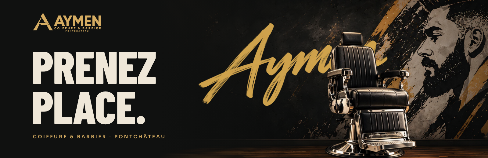
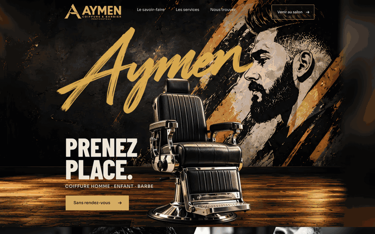
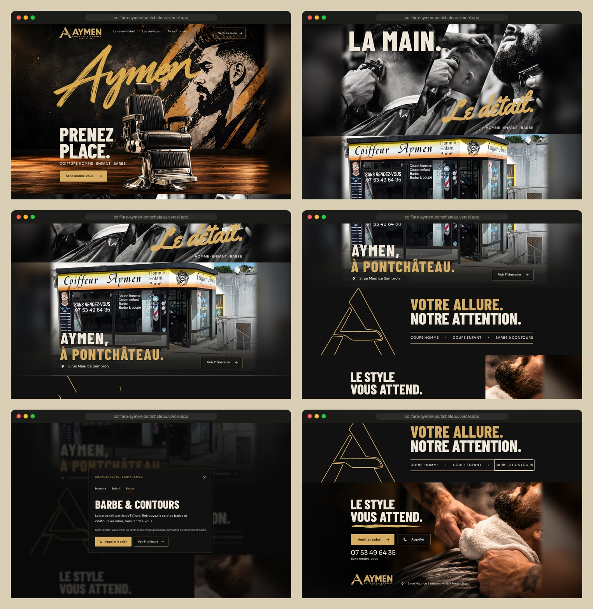
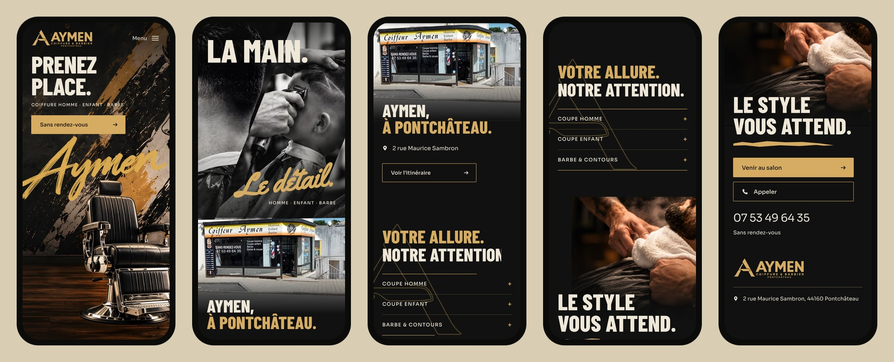
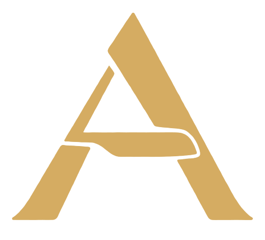

<div align="center">



<h3>A one-page website for a barber in Pontchâteau, built around a pinned barber chair and a five-strip "comb" passage.</h3>

<p>
  <a href="https://coiffure-aymen-pontchateau.vercel.app"><strong>🌐 Live site</strong></a>
  &nbsp;·&nbsp;
  <a href="#hero-animation"><strong>🎬 How the hero works</strong></a>
  &nbsp;·&nbsp;
  <a href="#getting-started"><strong>🛠️ Run it locally</strong></a>
</p>

<p>
  <a href="https://coiffure-aymen-pontchateau.vercel.app"></a>
  
  
  
  
</p>

</div>

<br />

## 🚀 Overview

**Coiffure Aymen** is a walk-in barber and hair salon at 2 rue Maurice Sambron in Pontchâteau: men's cuts, children's cuts, beard and line-ups, *sans rendez-vous*. The site is built on one image: **take a seat**. A leather and chrome chair stands in front of a painted mural with the Aymen brush signature behind it, and as you scroll, the black and white craft montage rises over it in five staggered strips, like a comb passing through.

The amber brush stroke is the thread through the page: the signature in the hero, *Le détail.* written by hand in the montage, the monogram's contour drawn in the services scene, and the stroke under *Le style vous attend.* before the phone number.

- **Approved board, reproduced**: the desktop is the client's approved model 3 board at the density of a 1024 px layout, with every line of text set at the board's measured baselines
- **Two actions only**: call the salon or open the route to it. No booking flow, prices or hours were invented
- **Built for every visitor**: reduced motion, Save-Data, a pause button and no-JS all show the complete page; keyboard-friendly services dialog
- **Light**: about 0.7 MB for the whole page on desktop and on phones (AVIF first, WebP fallback)

<br />

<a name="hero-animation"></a>

## 🎬 The hero animation

<div align="center">
  <a href="https://coiffure-aymen-pontchateau.vercel.app"></a>
  <sub>Scroll-scrubbed on the live site · captured at 1440 × 900</sub>
</div>

<br />

The hero stays pinned for one hero height (621 board px, 0.97 of a 1440 × 900 screen) while *Le savoir-faire* rises over it:

| Scroll  | What happens                                                                                         |
| :------ | :--------------------------------------------------------------------------------------------------- |
| Load    | The signature is revealed by a horizontal mask, the chair settles (scale 1.025 → 1, 16 px), the title rises |
| 0–100%  | The montage climbs over the chair with the scroll, and a wave runs through its five strips from left to right (each strip leads for 76% of the passage, 6% after its neighbour) |
| 18–57%  | Navigation and *Prenez place.* fade and lift, then become inert                                      |
| 18–72%  | The signature slides right and fades                                                                 |
| 30–92%  | The chair drifts left (74 px at most), rises 12 px and fades; the pointer moves it by 4 px at most  |
| 50–80%  | *Le détail.* is written in amber as the montage nears the top                                        |
| 100%    | The five strips line up exactly with the section; the street photo follows with no seam             |

**Under the hood**

- 🧩 **Real layers, not a flat picture.** Mural plate, signature, floor shadow, chair with alpha, then HTML text, so the lettering passes behind the chair and the words stay text.
- 📐 **Measured, not guessed.** Every plate was registered on the approved board (SIFT + similarity transform, masked template matching for the chair and signature) and every line of text was fitted by ink box (`scripts/fit-type.py`). `npm run compare` renders the page and lays it over the board.
- 🪮 **The comb.** The hero is `position: sticky` in a runway two heroes tall; the next section starts right under it with a negative margin, so it rises over the chair on plain scroll. Each of the five strips is the same montage clipped to a fifth of the width and moved by `-lead × sin(π·phase)`, which returns to exactly 0, so the section lands flat.
- 🌫️ **No zoom on wide screens.** The board is 748 px wide. Rather than scaling it up to the window, each photo is shown at board scale and continues into a blurred, darkened copy of itself that fades to charbon.
- 🐢 **Graceful by default.** Reduced motion, Save-Data, the pause button and `?static` remove the runway, the intro and every scrubbed effect: the page is the board, at rest.

<br />

## 🖥️ Sections

<div align="center">
  
</div>

<br />

| #   | Section                                  | Anchor          | Role                                                                                     |
| :-- | :--------------------------------------- | :-------------- | :--------------------------------------------------------------------------------------- |
| 01  | **Prenez place.**                        | `#accueil`      | The chair, the mural and the signature; walk-in call to action                           |
| 02  | **La main. Le détail.**                  | `#savoir-faire` | Black and white craft montage that rises in five strips; the accent is written by mask   |
| 03  | **Aymen, à Pontchâteau.**                | `#nous-trouver` | The salon's real shopfront, address and route; enters with a short diagonal cut          |
| 04  | **Votre allure. Notre attention.**       | `#prestations`  | The only plain scene: monogram contour drawn on scroll, three services that open a dialog |
| 05  | **Le style vous attend.**                | `#contact`      | Photo opening from the right, the brush stroke, route, call, phone number and footer     |

<br />

## 📱 Mobile first, motion optional

<div align="center">
  
</div>

<br />

- Phones get their own composition: title and call to action first, then the signature and the chair standing on the floor
- The comb passage runs on phones too; the street and contact photos become top bands that melt into charbon
- Services become a list of 54 px rows; every link is at least 40 px tall, most 44 px or more
- No horizontal scroll at 360 or 390 px; nothing depends on hover

<br />

## ✨ Highlights

- **🪮 One gesture per scene**: comb strips (savoir-faire), handwritten accent, diagonal cut (street), contour drawing and title wipes (services), photo opening and brush stroke (contact)
- **📞 Real contact only**: `tel:` links and Google Maps routes; the salon is walk-in only, so there is no booking button
- **🗂️ Accessible services dialog**: native `<dialog>`, tabs with arrows, Home and End, Escape, click outside and focus return
- **⏸️ Motion control**: pause button remembered in `localStorage`, `prefers-reduced-motion` and Save-Data respected, no permanent animation loop (one `requestAnimationFrame` per scroll event)
- **🖼️ Image pipeline**: the shopfront photo is cleaned of the viewer bar and upscaled with Real-ESRGAN; AVIF and WebP at the widths each plate is shown at (`npm run images`)
- **✅ Automated QA**: 71 checks with Playwright (layout at six sizes, comb passage, dialog keyboard, CTA hit tests, phone menu, reduced motion, pause, no-JS, no production notes on the page)

<br />

## 💻 Tech stack

| <br />Vite 6 | <br />JavaScript | <br />HTML5 | <br />CSS3 | <br />Python | <br />Vercel |
| :---: | :---: | :---: | :---: | :---: | :---: |

### Why this stack?

- **Vite + plain JavaScript**: a static one-pager; the whole interaction layer is 3 KB gzipped
- **No animation library**: the kit asks for event-driven frames and no permanent loop; sticky positioning does the pinning, a few transforms and clip paths do the rest
- **Python for the measurements**: OpenCV registration, Pillow type fitting and Real-ESRGAN run once, offline, and write the numbers the CSS uses
- **Self-hosted Barlow Condensed, Sora and Yellowtail** (WOFF2 subsets, 73 KB together)
- **Vercel**: every push to `main` deploys automatically

<br />

## 🎨 Design system

| Token    | Value                                                                        | Use                                              |
| :------- | :--------------------------------------------------------------------------- | :----------------------------------------------- |
| Charbon  |  | Page, services scene, shades                     |
| Ambre    |  | Signature, accents, buttons, rules, monogram     |
| Ivoire   |  | Titles and text                                  |
| Tabac    |  | Brand palette (wood tones of the hero)           |

- **Type**: Barlow Condensed 800 for titles, Sora 400/500 for the interface, Yellowtail for *Le détail.*; the Aymen signature is lettering art, not a font
- **Scale**: desktop sizes come from the board (`--u` = one board pixel at the density of a 1024 px board, capped at 1600 px and by the window height); small text never goes under 11 px
- **Layout**: the board's 748 px frame centred on the window, photos continuing to the edges
- **Motion**: entrances of 15 px over 700 ms, photo parallax at most ±14 px, no scale beyond 1.03

<br />

<a name="getting-started"></a>

## 🛠️ Getting started

```bash
# Clone the repository
git clone https://github.com/Jeanfr1/Coiffure-Aymen-Kit-website.git
cd Coiffure-Aymen-Kit-website

# Install dependencies (Node 20.9+)
npm install

# Start the dev server  →  http://localhost:4376
npm run dev

# Production build  →  dist/
npm run build

# Preview the production build  →  http://localhost:4377
npm run preview

# Checks against a running build
QA_BASE=http://localhost:4377/ npm run qa        # 71 checks
QA_BASE=http://localhost:4377/ npm run compare   # page over the approved board → qa/board-compare.png

# Regenerate the web images (scripts/out/plates comes from npm run prepare-images)
npm run images
```

`npm run register`, `npm run prepare-images` and `npm run fit-type` are the offline measurement steps; they need Python with OpenCV, Pillow and, for the upscale, PyTorch with the Real-ESRGAN x4plus weights.

<br />

## 📁 Project structure

```
Coiffure-Aymen-Kit-website/
├── index.html                  # The five scenes: accueil → savoir-faire → nous-trouver → prestations → contact
├── src/
│   ├── main.js                 # Comb passage, hero motion, per-scene effects, dialog, menu, pause
│   ├── styles/main.css         # Board layout in board px × --u, phone composition, motion states
│   ├── data/content.js         # Services dialog copy (French)
│   ├── data/board-type.json    # Measured sizes, tracking and baselines of every board line
│   └── assets/                 # Monogram contour, inlined at build time
├── public/                     # Fonts (WOFF2 + licences), img/ (AVIF/WebP), logo, icons, og-image, robots.txt
├── scripts/
│   ├── register-board.py       # Plates → board positions (SIFT)
│   ├── fit-type.py             # Board text → font size, tracking, baseline
│   ├── prepare-images.py       # Viewer bar crop, Real-ESRGAN, ambient side extensions
│   ├── build-images.mjs        # AVIF + WebP at display widths
│   ├── qa.mjs · compare-board.mjs · capture.mjs · readme-assets.mjs
├── references/                 # The approved model 3 board
├── roteiros/ · docs/ · motion/ # The client kit: scripts, copy, sources, timeline (LEIA-ME-KIT.md)
└── brand/ · fonts/ · images/   # Identity, original fonts and licences, campaign masters
```

<br />

## 🚀 Deployment

Hosted on **Vercel** and connected to this repository: every push to `main` ships to production. The kit folders are excluded from uploads by `.vercelignore`, and the site is `noindex` until it has its own domain.

**Live site:** [coiffure-aymen-pontchateau.vercel.app](https://coiffure-aymen-pontchateau.vercel.app)

| Setting          | Value           |
| :--------------- | :-------------- |
| Framework        | Vite            |
| Build command    | `npm run build` |
| Output directory | `dist`          |

<br />

## 📌 Content checklist

Items waiting on the salon. Each one is marked `TODO(aymen)` in `index.html`.

- [ ] Custom domain (then remove `noindex` in `index.html`, `vercel.json` and `robots.txt`, and add `canonical` and `og:url`)
- [ ] The salon's own Google Maps place link (the map buttons search the name and address for now)
- [ ] Permission to publish the shopfront photo (a capture of a photo posted on Google Maps)
- [ ] Mentions légales: SIRET and host details
- [ ] Confirm the three service descriptions; prices, hours and online booking stay off the page until the salon provides them
- [ ] Directories list older phone numbers: the site shows the one on the shopfront, **07 53 49 64 35**

Choices made where the kit and the board disagreed:

- The kit's hero mural has a lower horizon than the board's, so it is fitted to the hero height; the mural face is about 15% larger than on the board
- The kit's script has five strips drawing the montage over the hero; here the montage section itself rises in five strips, so it works on screens taller than the board's hero and lands exactly in place
- *Le détail.* is set in Yellowtail as the kit specifies; the board shows it as a heavier brush, so the font gets a light stroke of the same amber

<br />

## 🙏 Acknowledgments

- **Coiffure Aymen** for the shopfront photo and the choice of model 3
- **[Barlow Condensed](https://fonts.google.com/specimen/Barlow+Condensed)** by Jeremy Tribby and **[Sora](https://fonts.google.com/specimen/Sora)** by Jonathan Barnbrook and Julián Moncada (OFL), **[Yellowtail](https://fonts.google.com/specimen/Yellowtail)** by Astigmatic (Apache 2.0)
- **[Real-ESRGAN](https://github.com/xinntao/Real-ESRGAN)** for the shopfront upscale
- **[Vite](https://vite.dev)** and **[Vercel](https://vercel.com)**

<br />

---

<div align="center">
  
  <p><strong>Prenez place.</strong></p>
  <p>Built with ❤️ by <a href="https://github.com/Jeanfr1">Jean</a> for Coiffure Aymen</p>
  <sub>© 2026 Coiffure Aymen. All rights reserved.</sub>
</div>
